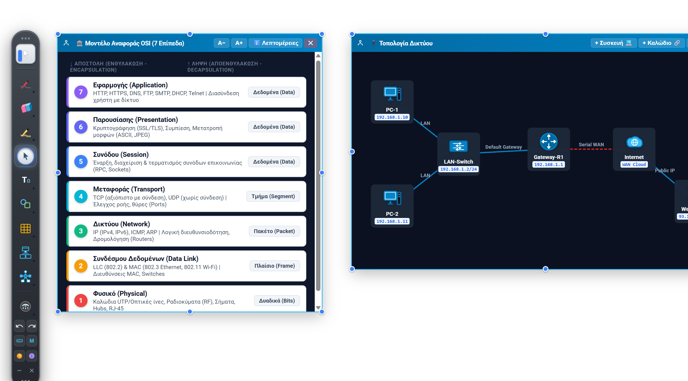

# myWhiteboard 🖊️📐
**Έκδοση:** 1.5.0 &bull; **Δημιουργός:** [Λέων Προκόπης (plarg.gr)](https://plarg.gr) &bull; [📘 Αναλυτικό Εγχειρίδιο Χρήστη (MANUAL.md)](./docs/MANUAL.md)

Μια σύγχρονη, ελαφριά και πανίσχυρη εφαρμογή **Whiteboard** και **Desktop Annotation** εμπνευσμένη από τα εργαλεία του **OpenBoard**, με πλήρη υποστήριξη για **Windows** και **Linux**, γραμματοσειρά **Google Roboto** και πλήρη υποστήριξη ελληνικών χαρακτήρων.


---

## 🌟 Χαρακτηριστικά

### 1. Εργαλεία OpenBoard & Έναρξη Εφαρμογής
- **Εξ ορισμού κατάσταση έναρξης (Default Mouse Mode):**
  - Όταν ξεκινά η εφαρμογή, **δεν είναι επιλεγμένο κανένα εργαλείο σχεδίασης** και το ποντίκι συνεχίζει να λειτουργεί κανονικά.
  - Η διαπερατότητα κλικ (**click-through**) στην επιφάνεια εργασίας είναι άμεσα ενεργή, επιτρέποντας άμεση αλληλεπίδραση με τα υπόλοιπα παράθυρα.
- **Εναλλαγή σε Ποντίκι (Mouse / Pointer Mode):**
  - Σε κατάσταση **Επιφάνειας Εργασίας (Desktop Mode)**, ενεργοποιείται αυτόματα η διαπερατότητα των κλικ (**click-through**) ώστε να μπορείτε να εργάζεστε κανονικά στα παράθυρα και τα προγράμματά σας (π.χ. φυλλομετρητή, IDE, Word, PDF reader, κ.λπ.), ενώ οι σημειώσεις σας παραμένουν ορατές στην οθόνη!
  - Όταν το ποντίκι πλησιάζει την εργαλειοθήκη ή τα ενεργά στοιχεία (πίνακες, κείμενα), αποκρίνεται άμεσα για επιλογή και επεξεργασία.
- **Μολύβι (Pen):**
  - 3 προεπιλογές πάχους (Λεπτό 3px, Μεσαίο 7px, Παχύ 15px).
  - Πλούσια παλέτα χρωμάτων (Μαύρο, Άσπρο, Κόκκινο, Μπλε, Σκούρο Μπλε, Πράσινο, Κίτρινο, Πορτοκαλί, Μωβ) + πλήρης επιλογέας προσαρμοσμένου χρώματος (Color Picker).
  - Ομαλοποίηση γραμμής με καμπύλες Bezier.
- **Σβήστρα (Eraser):**
  - 3 μεγέθη σβήστρας (Μικρή 20px, Μεσαία 45px, Μεγάλη 85px).
  - Δυναμικός κυκλικός κέρσορας που απεικονίζει ακριβώς την περιοχή σβησίματος.
  - Δυνατότητα άμεσου καθαρισμού όλης της επιφάνειας («Καθαρισμός Όλων»).
- **Μαρκαδοράκι (Highlighter / Υπογραμμιστής):**
  - Ημιδιαφανής σχεδίαση που αναδεικνύει το κείμενο ή τα γραφικά χωρίς να τα κρύβει.
  - 3 πάχη υπογράμμισης (16px, 28px, 48px).
  - 5 φωσφοριζέ νέον χρώματα (Κίτρινο, Πράσινο, Γαλάζιο, Ροζ, Πορτοκαλί).

### 2. Γεωμετρικά Σχήματα & Ενσωματωμένο Κείμενο
- **Ευθεία γραμμή & Βελάκι κατεύθυνσης:**
  - Σχεδιάζονται ελεύθερα με σύρσιμο προς οποιαδήποτε κατεύθυνση και γωνία απευθείας στην οθόνη.
  - Χωρίς περιεχόμενο κειμένου, ακριβώς όπως στον αρχικό σχεδιασμό.
- **Κλειστά Γεωμετρικά Σχήματα (Ορθογώνιο, Πλάγιο Παραλληλόγραμμο, Κύκλος, Έλλειψη, Ρόμβος):**
  - **Ενσωμάτωση Κειμένου (Text Inside Shapes):** Μπορούν να δεχθούν κείμενο με γραμματοσειρά Google Roboto (πλήρης υποστήριξη ελληνικών).
  - **Αυτόματη Αναδίπλωση (Word-Wrap):** Το κείμενο αλλάζει γραμμή αυτόματα μέσα στο σχήμα.
  - **Δυναμική Αυξομείωση Μεγέθους Γραμμάτων (Auto-Fit Scaling):** Τα γράμματα **μικραίνουν σταδιακά** όσο πληκτρολογείτε και γεμίζει το σχήμα. Αν **μεγαλώσετε το σχήμα**, τα γράμματα **μεγαλώνουν αναλογικά** για να καταλάβουν το διαθέσιμο χώρο!
  - **Ασφαλές Padding:** Ειδικά υπολογισμένο περιθώριο ανά γεωμετρία (κύκλος, ρόμβος, πλάγιο, έλλειψη) ώστε το κείμενο να μένει πάντα καθαρά μέσα στα όρια του σχήματος.
  - **8 Λαβές Αυξομείωσης Μεγέθους (NW, N, NE, E, SE, S, SW, W)** σε κάθε σχήμα.
  - **Πλήρης Έλεγχος Χρωμάτων:** Επιλογή χρώματος περιγράμματος, γεμίσματος (με επιλογή διαφάνειας) και **χρώματος γραμμάτων (Text Color)** τόσο από την εργαλειοθήκη όσο και απευθείας σε κάθε σχήμα.

### 3. Δομές Δεδομένων για Γλώσσες Προγραμματισμού & Αλγορίθμους (Data Structures)
Πλήρης σουίτα οπτικοποίησης βασικών δομών δεδομένων για εκπαιδευτική χρήση (ΓΛΩΣΣΑ, Python, C/C++, Java, Αλγόριθμοι):

- **🔍 Αυξομείωση Μεγέθους 5 Επιπέδων (A− / A+) σε ΚΑΘΕ Δομή:**
  - Κουμπιά **`A−`** και **`A+`** στην κεφαλίδα κάθε δομής (Πίνακας, Στοίβα, Ουρά, Συνδεδεμένη Λίστα).
  - **5 διαφορετικά διαβαθμισμένα μεγέθη:**
    1. **1/5: Πολύ Μικρό (XS)**
    2. **2/5: Μικρό (S)**
    3. **3/5: Μεσαίο (M - Προεπιλογή)**
    4. **4/5: Μεγάλο (L)**
    5. **5/5: Πολύ Μεγάλο (XL)**
  - Ταυτόχρονη αναλογική κλιμάκωση όλων των γραμμάτων, περιεχομένων κελιών, δεικτών (`[i]`, `front`, `rear`, `top`), συνδέσμων και διαστάσεων της δομής — ιδανικό για παρουσίαση σε διαδραστικό πίνακα και βιντεοπροβολέα!

#### ▦ Πίνακες (Arrays & 2D Tables)
- **Επιλογή Διαστάσεων:** Ορισμός Γραμμών και Στηλών (π.χ. 3×4, 1×10, έως 15×15) μέσω βημάτων ή διαδραστικού πίνακα επιλογής.
- **8 λαβές αυξομείωσης μεγέθους (NW, N, NE, E, SE, S, SW, W):** Ελεύθερη αλλαγή μεγέθους τραβώντας οποιαδήποτε πλευρά ή γωνία!
- **Δείκτες Γραμμών & Στηλών (Array Indices / Subscripts):**
  - `none`: Απλός πίνακας.
  - `0-based`: Αρίθμηση από `0` (Python, C, C++, Java, JavaScript).
  - `1-based`: Αρίθμηση από `1` (ΓΛΩΣΣΑ, Pascal, Fortran, MATLAB, R).
  - **Κουμπί `[0/1]` στην κεφαλίδα:** Άμεση κυκλική εναλλαγή δεικτών (`none` → `0-based` → `1-based`) διατηρώντας τα περιεχόμενα των κελιών!
- **Όνομα & Διάσταση Πίνακα (Array Badge):**
  - Εμφάνιση ετικέτας με το όνομα και τις διαστάσεις, π.χ. `A[3×4]`.
  - Κάντε κλικ στο badge ή στη γωνία `(0,0)` για άμεση μετονομασία του πίνακα (π.χ. `PIN`, `MATRIX`, `B`).
- **Τυχαίο Γέμισμα Δεδομένων (Random Data Fill - Κουμπί 🎲):**
  - **Ακέραιοι αριθμοί (Integers):** Επιλογή ελάχιστου και μέγιστου ορίου (π.χ. 1-10, 1-50, 1-100, -20 έως 20, 0 ή 1 για δυαδικούς πίνακες).
  - **Πραγματικοί αριθμοί (Floats):** Επιλογή ορίων και πλήθους δεκαδικών ψηφίων (1 ή 2 δεκαδικά, π.χ. 0.0 - 10.0, 4.72).
  - **Ελληνικά Ονόματα (Database 60+ ονομάτων):** Αυτόματο τυχαίο γέμισμα με ονόματα (Γιώργος, Μαρία, Νίκος, Ελένη, Δημήτρης, Κώστας, κ.λπ.) έτοιμα για παρουσίαση ασκήσεων αναζήτησης/ταξινόμησης!
  - **Επιλογές 1, 2 ή 3 κειμένων:** Τυχαία επιλογή μεταξύ προσαρμοσμένων κειμένων (π.χ. `Α, Γ` ή `Αληθής, Ψευδής` ή `True, False` ή `Ναι, Όχι` ή `Θετικός, Αρνητικός, Μηδέν`).
  - **Πρότυπα Αρίθμησης (Sequence & Patterns):** Αύξουσα από 1 (`1, 2, 3...`), αύξουσα από 0 (`0, 1, 2...`), μηδενικός πίνακας (`0`), μοναδιαίος πίνακας (διαγώνιος `1`).
- **📐 Τόνιση Κύριας & Δευτερεύουσας Διαγωνίου (Τετραγωνικοί Πίνακες):**
  - Σε τετραγωνικούς πίνακες ($N \times N$), εμφανίζεται στην κεφαλίδα το κουμπί **`⤢`**.
  - Κυκλική εναλλαγή με κάθε κλικ:
    1. **Κύρια Διαγώνιος (`i == j`):** Απαλό παστέλ κεχριμπαρί/χρυσό.
    2. **Δευτερεύουσα Διαγώνιος (`i + j == N + 1`):** Απαλή παστέλ λεβάντα/μωβ.
    3. **Και οι δύο Διαγώνιοι:** Ταυτόχρονη απεικόνιση με ειδικό ροζ/κοραλί χρώμα στο κεντρικό κελί τομής.
    4. **Απενεργοποίηση.**
- **🎨 Τόνιση Γραμμών & Στηλών με Κλικ στις Άκρες (Row/Col Edge Highlighting):**
  - Κάνοντας κλικ στην κεφαλίδα/άκρη οποιασδήποτε γραμμής (αριστερά) ή στήλης (επάνω), τονίζεται ολόκληρη η γραμμή ή η στήλη.
  - Χρωματική παλέτα υψηλής φωτεινότητας και αντίθεσης (απαλό γαλάζιο ουρανού για γραμμές, απαλή μέντα για στήλες, και απαλό τιρκουάζ στην τομή γραμμής & στήλης).
  - Τα περιεχόμενα των κελιών διατηρούν απόλυτη ευκρίνεια και αναγνωσιμότητα.
  - Με `Shift+Click` στην άνω αριστερή γωνία ή εκ νέου κλικ στην άκρη, ο τονισμός απενεργοποιείται άμεσα.
- **Γρήγορη Πλοήγηση:** Με το πλήκτρο `Tab` μεταβαίνετε αμέσως στο επόμενο κελί, και με `Shift+Tab` στο προηγούμενο.
- **Κουμπί Καθαρισμού (`⟳`):** Άμεσο άδειασμα όλων των κελιών με ένα κλικ.

#### 🥞 Στοίβα (Stack - LIFO)
- **Διπλή Οπτικοποίηση:**
  - **Κλασική Προβολή:** Κάθετος κάδος με ανοιχτή κορυφή, όπου τα στοιχεία εισάγονται από επάνω και εξάγονται με LIFO (Last-In-First-Out).
  - **Υλοποίηση με Μονοδιάστατο Πίνακα:** Πίνακας με δείκτες θέσεων και ξεχωριστή γραμμή ένδειξης για τον δείκτη `▲ top = X`.
- **Κουμπί Εναλλαγής Προβολής `[📊]`:** Άμεση μετατροπή μεταξύ Κλασικής προβολής και προβολής Πίνακα, διατηρώντας ακέραια τα δεδομένα και τον δείκτη!
- **Λειτουργίες Στοίβας:**
  - `+ Push`: Εισαγωγή νέου στοιχείου (με τιμή από το πεδίο εισαγωγής ή αυτόματη).
  - `- Pop`: Εξαγωγή του κορυφαίου στοιχείου.
  - `🎲`: Τυχαία εισαγωγή (ακέραιος ή ελληνικό όνομα).
  - `⟳`: Πλήρης καθαρισμός/άδειασμα.
- **Δείκτης Κορυφής (Top Pointer):** Εμφανίζεται δυναμικά δίπλα στο κορυφαίο στοιχείο (`◀ top = X`) στην κλασική προβολή και κάτω από το αντίστοιχο κελί στον πίνακα.
- **Ανίχνευση Υπερχείλισης & Υποχείλισης:**
  - Προειδοποιητικό status badge `⚠️ Υπερχείλιση! (Overflow)` όταν η στοίβα γεμίσει και γίνει απόπειρα Push.
  - Προειδοποιητικό status badge `⚠️ Υποχείλιση! (Underflow)` όταν η στοίβα είναι άδεια και γίνει απόπειρα Pop.
- **Εναλλαγή Αρίθμησης `[0/1]`:**
  - `1-based` (ΓΛΩΣΣΑ): Κελιά $1..N$, άδεια στοίβα με `top = 0`.
  - `0-based` (Python/C): Κελιά $0..N-1$, άδεια στοίβα με `top = -1`.
- **Άμεση Επεξεργασία:** Κάντε κλικ σε οποιοδήποτε κελί για απευθείας διόρθωση τιμών.

#### 🚶 Ουρά (Queue - FIFO)
- **Δύο Τύποι Λειτουργίας:**
  - **➡️ Γραμμική Ουρά (Linear Queue - Σχολικό Βιβλίο ΓΛΩΣΣΑΣ / ΑΕΠΠ):**
    - Ο δείκτης `rear` αυξάνεται δεξιότερα σε κάθε εισαγωγή (`Enqueue`).
    - Ο δείκτης `front` μετακινείται **δεξιότερα** σε κάθε εξαγωγή (`Dequeue`), αφήνοντας τα προηγούμενα κελιά κενά.
    - **Μηδενισμός:** Αν το `front` ξεπεράσει το `rear` (`front > rear`), η ουρά **αδειάζει αυτόματα** και οι δύο δείκτες γίνονται `front = 0` και `rear = 0`!
    - **Υπερχείλιση:** Η ουρά θεωρείται γεμάτη όταν `rear == N` (ακόμη κι αν υπάρχουν κενά κελιά στην αρχή).
  - **🔄 Κυκλική / Μετατόπιση (Shifting Queue):**
    - Κατά την εξαγωγή, όλα τα υπόλοιπα στοιχεία μεταφέρονται αυτόματα αριστερά (shift left), διατηρώντας το πρώτο στοιχείο πάντα στη θέση 1.
- **Κουμπί Εναλλαγής Τύπου `[➡️ Γραμμική / 🔄 Κυκλική]`:** Άμεση εναλλαγή μεταξύ των δύο μοντέλων λειτουργίας ανά πάσα στιγμή απευθείας από την κεφαλίδα της ουράς!
- **Διπλή Οπτικοποίηση:**
  - **Κλασική Προβολή:** Οριζόντιος αγωγός με ένδειξη `⬅ Έξοδος (Front)` στα αριστερά και `⬅ Είσοδος (Rear)` στα δεξιά (First-In-First-Out) και ετικέτες δεικτών `front`, `rear`, `f, r`.
  - **Υλοποίηση με Μονοδιάστατο Πίνακα:** Πίνακας με δείκτες θέσεων, **ξεχωριστή γραμμή δεικτών (`▲ front`, `▲ rear`) ακριβώς κάτω από τα αντίστοιχα κελιά** και γραμμή κατάστασης.
- **Κουμπί Εναλλαγής Προβολής `[📊]`:** Άμεση εναλλαγή μεταξύ Κλασικού αγωγού και υλοποίησης με Πίνακα.
- **Λειτουργίες Ουράς:**
  - `+ Enqueue`: Εισαγωγή στο πίσω άκρο (`rear`).
  - `- Dequeue`: Εξαγωγή από το μπροστινό άκρο (`front`).
  - `🎲`: Τυχαία εισαγωγή στοιχείου (ακέραιος ή ελληνικό όνομα).
  - `⟳`: Πλήρες άδειασμα ουράς (επαναφορά σε `front = 0, rear = 0`).
- **Ανίχνευση Υπερχείλισης & Υποχείλισης:** Οπτικά badges για `⚠️ Ουρά Γεμάτη (Overflow)!` και `⚠️ Ουρά Κενή (Underflow)!`.
- **Εναλλαγή Αρίθμησης `[0/1]`:** Υποστήριξη δεικτών `1-based` (ΓΛΩΣΣΑ) και `0-based` (C/Python).
- **Άμεση Επεξεργασία:** Κλικ σε οποιοδήποτε κελί για πληκτρολόγηση/διόρθωση.

#### 🔗 Συνδεδεμένη Λίστα (Linked List)
- **Οπτικοποίηση Κόμβων:**
  - Δείκτης κεφαλής `HEAD ➔`.
  - Κόμβοι με δύο τμήματα: **Πεδίο Δεδομένων (Data)** και **Πεδίο Δείκτη (Next Pointer •) ➔**.
  - Τερματικός δείκτης `⊘ nil` στο τέλος της λίστας.
- **Λειτουργίες Λίστας:**
  - `+ Αρχή`: Εισαγωγή νέου κόμβου στην κεφαλή (Head).
  - `+ Τέλος`: Εισαγωγή νέου κόμβου στο τέλος (Tail).
  - `- Αρχή`: Διαγραφή κόμβου από την κεφαλή.
  - `- Τέλος`: Διαγραφή κόμβου από το τέλος.
  - `🎲`: Εισαγωγή τυχαίου στοιχείου.
  - `⟳`: Καθαρισμός ολόκληρης της λίστας.
  - **Διαγραφή Ενδιάμεσου Κόμβου:** Κάθε κόμβος διαθέτει κουμπί `✕` (στο hover) για άμεση αφαίρεση οποιουδήποτε επιμέρους στοιχείου από τη λίστα!
#### 🌲 Δένδρα (Tree Data Structure - Κεφάλαιο 1.3.2)
- **Δυαδικά Δένδρα & Δένδρα Αναζήτησης:**
  - Δυνατότητα εισαγωγής **αριθμών, γραμμάτων ή λέξεων** σε κάθε κόμβο (π.χ. `48`, `A`, `root`, `Δωμάτιο;`, `*`, `+`).
  - Έτοιμα πρότυπα απευθείας από το σχολικό βιβλίο πληροφορικής:
    - **🌲 Δυαδικό Δένδρο Αναζήτησης (Εικόνα 1.3.14):** Ρίζα `48` $\rightarrow$ αριστερό `45` (`2`), δεξιό `70` (`66`, `83`).
    - **🧮 Δένδρο Αριθμητικής Έκφρασης (Εικόνα 1.3.20):** Υπολογισμός `(a+b)*c` με ρίζα `*`, αριστερά `+` (`a`, `b`) και δεξιά `c`.
    - **🤔 Δένδρο Απόφασης (Εικόνα 1.3.19):** Πρόβλημα καθαριότητας φοιτητικού σπιτιού (`Δωμάτιο;` $\rightarrow$ `Βρώμικο`/`Καθαρό` $\rightarrow$ `Σκούπισμα`/`Ξεκούραση`).
    - **🏢 Οργανόγραμμα / Ιεραρχικό Δένδρο (Εικόνα 1.3.17):** Ρίζα `Διευθυντής` $\rightarrow$ `Τμήμα Α`, `Τμήμα Β`, `Τμήμα Γ`.
    - **✨ Νέο Δένδρο:** Ξεκινά με ρίζα προσαρμοσμένης τιμής.
- **Διαδραστικές Λειτουργίες:**
  - `+ Αριστερό` / `+ Δεξί`: Προσθήκη αριστερού ή δεξιού παιδιού στον επιλεγμένο κόμβο.
  - `+ Παιδί`: Προσθήκη γενικού παιδιού (για γενικά δένδρα).
  - `- Διαγραφή`: Διαγραφή επιλεγμένου κόμβου και ολόκληρου του υποδένδρου του.
  - `🎲`: Εισαγωγή τυχαίας τιμής.
  - `⟳`: Επαναφορά δένδρου.
- **Ελεύθερη Διάταξη (Drag & Drop):** Κάθε κόμβος σύρεται ελεύθερα με το ποντίκι και οι συνδετικές ακμές SVG επανασχεδιάζονται δυναμικά σε πραγματικό χρόνο!
- **Άμεση Επεξεργασία:** Με διπλό κλικ σε οποιονδήποτε κόμβο αλλάζετε την τιμή του άμεσα.
- **Κλιμάκωση Μεγέθους 5 Επιπέδων (`A−` / `A+`):** Αναλογική αυξομείωση διαμέτρου κόμβων, γραμματοσειρών και πάχους ακμών.

#### 🕸️ Γράφοι (Graph Data Structure - Κεφάλαιο 1.3.3)
- **Κατευθυνόμενοι & Μη Κατευθυνόμενοι Γράφοι:**
  - Κουμπί **`⇄ / ➔`** στην κεφαλίδα για άμεση εναλλαγή μεταξύ **Μη Κατευθυνόμενου** (απλές ακμές) και **Κατευθυνόμενου** γράφου (ακμές με βέλη κατεύθυνσης).
  - Υποστήριξη αριθμών, γραμμάτων και λέξεων σε κάθε κόμβο (κορυφή).
  - Έτοιμα πρότυπα από το σχολικό βιβλίο:
    - **🌉 Επτά Γέφυρες του Königsberg (Εικόνα 1.3.30):** Το κλασικό πρόβλημα του Euler με 4 κορυφές (`A`, `B`, `C`, `D`), 7 γέφυρες (`γ1` έως `γ7`) και **καμπύλες πολλαπλές ακμές**!
    - **🌐 Παγκόσμιος Ιστός (Web Graph - Εικόνα 1.3.29):** Κατευθυνόμενος γράφος ιστοσελίδων (`R ➔ Q`, `Q ➔ P`, κ.λπ.).
    - **👥 Κοινωνικό Δίκτυο Facebook (Σελ. 56):** Μη κατευθυνόμενος γράφος αμοιβαίων φιλιών (`Γιώργος`, `Μαρία`, `Νίκος`, `Ελένη`).
    - **💠 Πλήρης Γράφος $K_4$:** 4 κόμβοι, 6 ακμές.
    - **✨ Κενός Γράφος:** Ελεύθερη προσθήκη κόμβων και συνδέσεων.
- **Διαδραστικές Λειτουργίες:**
  - `+ Κόμβος`: Προσθήκη νέας κορυφής με όνομα/τιμή από το πεδίο εισαγωγής.
  - `+ Ακμή`: Σύνδεση επιλεγμένου κόμβου με άλλον κόμβο, με δυνατότητα εισαγωγής ετικέτας ή βάρους (weight).
  - `- Διαγραφή`: Διαγραφή επιλεγμένου κόμβου ή επιλεγμένης ακμής.
  - `🎲`: Δημιουργία τυχαίου γράφου.
  - `⟳`: Επαναφορά γράφου.
- **Ελεύθερη Μετακίνηση Κορυφών (Drag & Drop):** Σύρετε οποιονδήποτε κόμβο για να διαμορφώσετε την τέλεια διάταξη στον πίνακα, με ζωντανή αναπροσαρμογή ευθύγραμμων και καμπύλων ακμών!
- **Κλιμάκωση Μεγέθους 5 Επιπέδων (`A−` / `A+`):** Προσαρμογή μεγέθους κορυφών, ετικετών και βαρών.

### 4. Αντικειμενοστραφής Προγραμματισμός (OOP Diagrams - Κεφάλαιο 4 & Πανελλαδικές / Διαγωνίσματα)
Πλήρης υποστήριξη διαγραμμάτων αντικειμενοστραφούς σχεδίασης ακριβώς όπως παρουσιάζονται στις ενότητες 4.2, 4.3 και 4.4 του σχολικού βιβλίου και στα θέματα εξετάσεων:

#### 📦 Διάγραμμα Αντικειμένων (Object Diagram - Ενότητα 4.2)
- **Κουτί Αντικειμένου (Object Box):**
  - Επικεφαλίδα: `Όνομα (Κλάση)` σε έντονη μπλε γραφή (π.χ. `Μαθητής (Γιώργος)`, `Καθηγητής (Νίκος)`, `Όχημα (Αυτοκίνητο)`).
  - Τμήμα Ιδιοτήτων: Λίστα χαρακτηριστικών με τις συγκεκριμένες τιμές τους.
  - **Στικτή Διαχωριστική Γραμμή (Dotted Separator)** ανάμεσα σε ιδιότητες και μεθόδους.
  - Τμήμα Μεθόδων: Λειτουργίες / ενέργειες του αντικειμένου (π.χ. `Μελετά()`, `Διδάσκει()`, `Μεταφέρει()`).
- **Πλούσια Έτοιμα Εκπαιδευτικά Πρότυπα Αντικειμένων:**
  - **🏫 Σχολική Μονάδα:**
    - `👨‍🎓 Μαθητής (Γιώργος)`: Όνομα, Επώνυμο, Πατρώνυμο, Διεύθυνση, Τηλέφωνο, ΑΜ (1042), Ημ. Εγγραφής, Τάξη (Γ' Λυκείου) | `Μελετά()`, `ΣυμμετέχειΣεΕξετάσεις()`, `ΔανείζεταιΒιβλίο()`.
    - `👩‍🎓 Μαθήτρια (Μαρία)`: Όνομα, Επώνυμο, Πατρώνυμο, Διεύθυνση, Τηλέφωνο, ΑΜ (1058), Ημ. Εγγραφής, Τάξη (Γ' Λυκείου) | `Μελετά()`, `ΕπιλύειΑσκήσεις()`, `ΥποβάλλειΕργασία()`.
    - `👨‍🏫 Καθηγητής (Νίκος)`: Όνομα, Επώνυμο, Πατρώνυμο, Διεύθυνση, Τηλέφωνο, ΑΜ Εκπαιδευτικού (58210), Ειδικότητα (ΠΕ86 Πληροφορικής), Ημ. Διορισμού | `Διδάσκει()`, `Βαθμολογεί()`, `ΑναθέτειΕργασία()`.
    - `👩‍🏫 Καθηγήτρια (Πετρούλα)`: Όνομα, Επώνυμο, Πατρώνυμο, Διεύθυνση, Τηλέφωνο, ΑΜ Εκπαιδευτικού (60124), Ειδικότητα (ΠΕ03 Μαθηματικών), Ημ. Διορισμού | `Διδάσκει()`, `Εξετάζει()`, `ΕνημερώνειΓονείς()`.
    - `💼 Προσωπικό (Δημήτρης)`: Όνομα, Επώνυμο, Πατρώνυμο, Διεύθυνση, Τηλέφωνο, Αρ. Μητρώου (ΥΠ-402), Καθήκον (Τεχνική Υποστήριξη Εργαστηρίου), Ωράριο | `ΣυντηρείΕξοπλισμό()`, `ΔιαχειρίζεταιΑποθήκη()`, `ΑναφέρειΒλάβη()`.
    - `🌟 Πλήρες Σύστημα Σχολείου`: Αυτόματη τοποθέτηση και των 4 αντικειμένων με συνδέσεις διδασκαλίας και εργαστηριακής υποστήριξης.
  - **🚗 Οχήματα & Μετακίνηση:**
    - `🚗 Όχημα (Αυτοκίνητο)`: Αριθμός Κυκλοφορίας (ΙΗΖ-4589), Μάρκα (Toyota Yaris), Κυβισμός (1496 cc), Είδος Καυσίμου (Υβριδικό), Επιβάτες (5), Χρώμα (Ασημί) | `Εκκίνηση()`, `Επιτάχυνση()`, `Μεταφέρει()`, `Στάθμευση()`.
    - `🏍️ Όχημα (Μηχανή)`: Αριθμός Κυκλοφορίας (ΒΚΑ-782), Μάρκα (Honda CB500), Κυβισμός (471 cc), Καύσιμο (Βενζίνη), Επιβάτες (2), Ιπποδύναμη (48 hp) | `Εκκίνηση()`, `Επιτάχυνση()`, `Μεταφέρει()`, `Ελιγμός()`.
    - `🚲 Όχημα (Ποδήλατο)`: Μάρκα (Ideal Integrator), Τύπος (Trekking), Μέγεθος (52cm), Ταχύτητες (21), Φρένα (Δισκόφρενα) | `ΚάνειΠεντάλ()`, `ΑλλάζειΤαχύτητα()`, `Φρενάρει()`, `Κουδουνίζει()`.
    - `🌟 Στόλος Οχημάτων`: 3 οχήματα με συγκριτικές διαστάσεις και συνδέσεις.
  - **✈️ Αεροπορική Εταιρεία:**
    - `👨‍✈️ Πιλότος (Αλέξανδρος)`: Ονοματεπώνυμο, Έτος Πρόσληψης, Σπουδές, Τύπος Αεροσκάφους (Airbus A320), Ώρες Πτήσης (6200) | `ΧειρίζεταιΑεροσκάφος()`, `ΕλέγχειΣχέδιοΠτήσης()`, `Προσγειώνει()`.
    - `👩‍✈️ Αεροσυνοδός (Ελένη)`: Ονοματεπώνυμο, Έτος Πρόσληψης, Σπουδές, Γλώσσες, Πιστοποίηση EASA | `ΕνημερώνειΕπιβάτες()`, `ΕξυπηρετείΚαμπίνα()`, `ΠαρέχειΠρώτεςΒοήθειες()`.
    - `🔧 Μηχανικός Αεροσκαφών (Κώστας)`: Ονοματεπώνυμο, Έτος Πρόσληψης, Σπουδές, Ειδικότητα (Κινητήρες Jet), Άδεια B1/Part-66 | `ΣυντηρείΑεροσκάφος()`, `ΕλέγχειΣυστήματα()`, `ΕγκρίνειΠτήση()`.
  - **🌾 Αγροτική Παραγωγή:**
    - `🚜 Γεωργός (Γιώργος)`: Ονοματεπώνυμο, ΑΦΜ, Έδρα (Λάρισα), Έκταση (180 Στρέμματα), Καλλιέργεια (Σιτηρά), Τρακτέρ | `ΥποβάλλειΔήλωση()`, `ΚαλλιεργείΓη()`, `Συγκομίζει()`.
    - `🐑 Κτηνοτρόφος (Γιάννης)`: Ονοματεπώνυμο, ΑΦΜ, Έδρα (Τρίκαλα), Αριθμός Ζώων (350), Είδος Ζώων (Αιγοπρόβατα) | `ΥποβάλλειΔήλωση()`, `ΕκτρέφειΖώα()`, `ΠαράγειΓάλα()`.
  - **🎬 Ψηφιακό Περιεχόμενο:**
    - `🎬 Βίντεο (Μάθημα OOP)`: Κωδικός (VID-408), Τίτλος, Κόστος Χρήσης (0.00 €), Δημιουργός, Γλώσσα (Ελληνικά), Ανάλυση (1080p), Διάρκεια | `Αναπαραγωγή()`, `Παύση()`, `Μεταφόρτωση()`.
    - `🎵 Ήχος (Podcast Επιστήμης)`: Κωδικός (AUD-205), Τίτλος, Κόστος Χρήσης (0.00 €), Συνθέτης, Ρυθμός Δειγματοληψίας (44.1 kHz), Bitrate (320 kbps) | `Αναπαραγωγή()`, `ΡύθμισηΈντασης()`, `Μεταφόρτωση()`.
  - **🍕 e-Pizza Delivery:**
    - `Πελάτης (Μαρία)`, `Πιτσαρία (Αλέξανδρος)`, `Διανομέας (Πέτρος)` & `🌟 Πλήρες Σύστημα e-Pizza` με συνδέσεις παραγγελίας, ανάθεσης και παράδοσης!
  - **💐 Αποστολή Λουλουδιών:**
    - `🌟 Πλήρες Σύστημα` και των 6 αντικειμένων (`Μαμά`, `Γιώργος`, `Άννα`, `Τζιοβάνι`, `Αντόνιο`, `Πέπε`) με τις 5 γραμμές συνεργασίας και ετικέτες ροής.

#### 🏛️ Διάγραμμα Κλάσεων (Class Diagram - Ενότητα 4.3 & Εξετάσεις)
- **Κουτί Κλάσης (Class Box):**
  - Επικεφαλίδα: Όνομα κλάσης σε έντονη γραφή.
  - **Σκιασμένο Φόντο Ιδιοτήτων (`#e9eff5`):** Ειδικό απαλό φόντο στο τμήμα των ιδιοτήτων ακριβώς όπως στο σχολικό βιβλίο.
  - **Στικτή Διαχωριστική Γραμμή (Dotted Line)**.
  - Τμήμα Μεθόδων σε λευκό φόντο.
- **Πλήρης Αντιστοίχιση Έτοιμων Κλάσεων:**
  - `👨‍🎓 Κλάση: Μαθητής` (Όνομα, Επώνυμο, Πατρώνυμο, Διεύθυνση, Τηλέφωνο, ΑΜ Μαθητή, Ημ. Εγγραφής, Τάξη | Μελετά(), ΣυμμετέχειΣεΕξετάσεις(), ΥποβάλλειΕργασία(), ΔανείζεταιΒιβλίο()).
  - `👨‍🏫 Κλάση: Εκπαιδευτικός / Καθηγητής` (Όνομα, Επώνυμο, Πατρώνυμο, Διεύθυνση, Τηλέφωνο, ΑΜ Εκπαιδευτικού, Ειδικότητα, Ημ. Διορισμού, Μισθός | Διδάσκει(), Βαθμολογεί(), ΑναθέτειΕργασία(), ΕνημερώνειΓονείς()).
  - `💼 Κλάση: Προσωπικό` (Όνομα, Επώνυμο, Πατρώνυμο, Διεύθυνση, Τηλέφωνο, Αρ. Μητρώου, Καθήκον, Ωράριο | ΣυντηρείΕξοπλισμό(), ΔιαχειρίζεταιΑποθήκη(), ΑναφέρειΒλάβη()).
  - `👤 Κλάση: Άτομο (Υπερκλάση)` (Όνομα, Επώνυμο, Πατρώνυμο, Διεύθυνση, Τηλέφωνο | Ταυτοποίηση(), Επικοινωνία()).
  - `🚗 Κλάση: Αυτοκίνητο`, `🏍️ Κλάση: Μοτοσυκλέτα`, `🚲 Κλάση: Ποδήλατο`, `🚚 Κλάση: Όχημα (Υπερκλάση)`.
  - `🍕 Κλάση: Πελάτης Πιτσαρίας`, `🏪 Κλάση: Πιτσαρία`, `🛵 Κλάση: Διανομέας`.
  - `👨‍✈️ Κλάση: Πιλότος`, `👩‍✈️ Κλάση: Αεροσυνοδός`, `🔧 Κλάση: Μηχανικός Αεροσκαφών`, `👔 Κλάση: Εργαζόμενος (Υπερκλάση)`.
  - `🚜 Κλάση: Γεωργός`, `🐑 Κλάση: Κτηνοτρόφος`, `💼 Κλάση: Επαγγελματίας (Υπερκλάση)`.
  - `🎬 Κλάση: Βίντεο`, `🎵 Κλάση: Ήχος`, `💿 Κλάση: Ψηφιακό Περιεχόμενο (Υπερκλάση)`.
  - `💐 Πλήρες Σύστημα Κλάσεων «Αποστολή Λουλουδιών»` (Πελάτης, Ανθοπώλης, Ταχυμεταφορέας, Ανθοδέτης).
  - `🐕 Κλάση: Σκύλος` (Όνομα, Ράτσα, Μέγεθος, Ηλικία, Χρώμα | Τρώω(), Κοιμάμαι(), Τρέχω(), Γαβγίζω()).

#### 🧬 Διάγραμμα Κληρονομικότητας (Inheritance Hierarchy - Ενότητα 4.4 & Εικόνα 4.10)
- **Ιεραρχία Κλάσεων & Σύμβολο Γενίκευσης UML:**
  - **Υπερκλάση / Γονέας:** Τοποθετημένη επάνω, περιλαμβάνει όλες τις κοινές ιδιότητες σε σκιασμένο φόντο.
  - **Ειδικό Σύμβολο Γενίκευσης UML (Generalization ⮉):** Λευκό/κενό ισόπλευρο τρίγωνο στραμμένο προς τα επάνω προς την υπερκλάση.
  - **Οριζόντια Γραμμή Διακλάδωσης:** Κατανέμει την κληρονομικότητα στις υποκλάσεις.
  - **Υποκλάσεις / Παιδιά:** Εμφανίζουν μόνο τις δικές τους εξειδικευμένες ιδιότητες και μεθόδους, κληρονομώντας τις κοινές από τη «μητέρα» κλάση!
- **Έτοιμα Πρότυπα Ιεραρχιών:**
  - **🏫 Σχολική Μονάδα:** `Άτομο` $\rightarrow$ `Μαθητής`, `Εκπαιδευτικός`, `Προσωπικό`.
  - **🚗 Οχήματα:** `Όχημα` $\rightarrow$ `Αυτοκίνητο`, `Μοτοσυκλέτα`, `Ποδήλατο`.
  - **✈️ Αεροπορική Εταιρεία:** `Εργαζόμενος` $\rightarrow$ `Πιλότος`, `Αεροσυνοδός`, `Μηχανικός Αεροσκαφών`.
  - **🌾 Αγροτική Παραγωγή:** `Επαγγελματίας` $\rightarrow$ `Γεωργός`, `Κτηνοτρόφος`.
  - **🎬 Ψηφιακό Περιεχόμενο:** `Ψηφιακό Περιεχόμενο` $\rightarrow$ `Βίντεο`, `Ήχος`.
  - **💐 Επαγγελματίες Ανθοπωλείου:** `Επαγγελματίας` $\rightarrow$ `Ανθοπώλης`, `Ανθοδέτης`, `Ταχυμεταφορέας`.
  - **📐 Γεωμετρικά Σχήματα:** `Γεωμετρικό Σχήμα` $\rightarrow$ `Τρίγωνο`, `Ορθογώνιο`, `Κύκλος`.
  - **🐾 Κατοικίδια Ζώα:** `Κατοικίδιο Ζώο` $\rightarrow$ `Σκύλος`, `Γάτα`.
- **Πλήρες CRUD (Δημιουργία, Προβολή, Επεξεργασία, Διαγραφή) σε Κάθε Στοιχείο:**
  - **Προσθήκη Καρτών με Αναδυόμενο Μενού (`+ Κλάση ▾` / `+ Αντικείμενο ▾` / `+ Υποκλάση ▾`):** Κάνοντας κλικ στο κουμπί προσθήκης εμφανίζεται αναδυόμενο μενού όπου στην κορυφή βρίσκεται η επιλογή Κενής Κάρτας (`✨ Κενό Αντικείμενο` / `✨ Κενή Κλάση`), ακολουθούμενη από όλα τα έτοιμα πρότυπα ταξινομημένα ανά θεματική ενότητα.
  - **Προσθήκη Σχέσεων (`+ Σχέση 🔗`):** Διαδραστική επιλογή κάρτας-πηγής και κάρτας-στόχου με μπλε banner καθοδήγησης, δημιουργία βέλους και αυτο-συσχετίσεων (self-loops).
  - **Προσθήκη Κληρονομικότητας (`+ Κληρονομικότητα 🧬`):** Σύνδεση υποκλάσης με υπερκλάση με το επίσημο λευκό τρίγωνο γενίκευσης UML (⮉).
  - **Διαδραστικό Badge Σχέσης:** Άμεση εναλλαγή τύπου σχέσης (`🔗` ⇄ `🧬`), επεξεργάσιμο κείμενο ρόλου (contenteditable) και κουμπί διαγραφής γραμμής `✕`.
  - **Διαγραφή Καρτών (`✕`):** Κάθε κάρτα αντικειμένου ή κλάσης διαθέτει κουμπί `✕` για άμεση αφαίρεση, με αυτόματο καθαρισμό των συνδεδεμένων γραμμών και ανασύνταξη του δένδρου ιεραρχίας.
  - **Διαχείριση Ιδιοτήτων & Μεθόδων:** Προσθήκη με κουμπιά `+Ιδ` / `+Μεθ` ή με πάτημα `Enter`. Διαγραφή μεμονωμένης γραμμής με το κουμπί `✕` (hover) ή με `Backspace`.
  - **Ελεύθερο Σύρσιμο (Drag & Drop):** Μετακίνηση καρτών με δυναμική, ομαλή επανασχεδίαση όλων των ακμών και ετικετών σε πραγματικό χρόνο.
  - **Κλιμάκωση 5 Επιπέδων (`A−` / `A+`):** Αυξομείωση μεγέθους όλων των καρτών και γραμματοσειρών.

### 5. Δίκτυα Υπολογιστών (Computer Networks - OSI, TCP/IP, Τοπολογίες, Πλαίσια & Πακέτα)
- **Μοντέλα Αναφοράς:**
  - 🏛️ **Μοντέλο OSI (7 Επίπεδα):** Πλήρης στοίβα επιπέδων (Εφαρμογής, Παρουσίασης, Συνόδου, Μεταφοράς, Δικτύου, Συνδέσμου Δεδομένων, Φυσικό), πρωτόκολλα, PDU (Data, Segment, Packet, Frame, Bits), ένδειξη ροής ενθυλάκωσης/αποενθυλάκωσης και κουμπί απόκρυψης/εμφάνισης λεπτομερειών.
  - ⚡ **Μοντέλο TCP/IP (4 Επίπεδα - RFC 1122):** Επίπεδα Εφαρμογής, Μεταφοράς, Διαδικτύου και Πρόσβασης Δικτύου με τα αντίστοιχα πρωτόκολλα.
  - 🔄 **Σύγκριση & Αντιστοίχιση OSI ↔ TCP/IP:** Παράλληλη παράθεση και οπτικοποίηση αντιστοίχισης (ενοποίηση επιπέδων 7, 6, 5 στο Εφαρμογής και 2, 1 στο Πρόσβασης Δικτύου).
- **Σχεδιαστής Τοπολογίας Δικτύου:**
  - Σχεδιασμός τοπολογιών με διανυσματικά σύμβολα Cisco-style: Router, Switch, Hub, Firewall, Access Point, PC, Laptop, Server, Smartphone, Cloud/Internet.
  - Έτοιμα πρότυπα: Τοπικό LAN (Αστέρας), Διασύνδεση LAN με Router & Cloud (WAN/Internet), Ασύρματο Wi-Fi (WLAN), Δίαυλος (Bus), Δακτύλιος (Ring), Κενός Καμβάς.
  - Σύρσιμο συσκευών με δυναμική επανασχεδίαση καλωδίων σε πραγματικό χρόνο, επεξεργάσιμα ονόματα και διευθύνσεις IP, προσθήκη καλωδίων Ethernet, Serial και Wi-Fi.
- **Διαδραστικά Πακέτα & Εκπαιδευτικοί Πίνακες:**
  - 🔢 **Αντιστοιχία Συστημάτων (Δεκαδικό 0-15 ↔ Hex 0-F ↔ Δυαδικό 4-bit):**
    - Πλήρης πίνακας αντιστοιχιών από το 0 έως το 15, χωρισμένος σε δύο παράλληλα μπλοκ (0-7 και 8-15) για άμεση εποπτική παρουσίαση.
    - Χάρακας βαρών θέσεων 4-bit (1 Nibble): $2^3 = 8$, $2^2 = 4$, $2^1 = 2$, $2^0 = 1$.
    - Στήλη ανάλυσης αθροίσματος δυνάμεων (π.χ. $13 = 8 + 4 + 1 \rightarrow \text{D} \rightarrow 1101$).
    - Ειδική επισήμανση των δεκαεξαδικών ψηφίων A, B, C, D, E, F με διακριτό χρώμα.
    - Πλήρης υποστήριξη λειτουργίας Κουίζ (**🙈 Απόκρυψη Πεδίων**), όπου τα δεκαδικά παραμένουν ορατά ως ερωτήσεις και με ένα κλικ αποκαλύπτεται το δεκαεξαδικό και δυαδικό ισοδύναμο!
    - Θεμελιώδες εκπαιδευτικό εργαλείο για διευθύνσεις IPv6 (128-bit) και MAC (48-bit).
  - 🌐 **Αυτοδύναμο Πακέτο IPv6 (IPv6 Datagram):** Χάρακας bits 0-31, δείκτες bytes, όλα τα πεδία κεφαλίδας, διευθύνσεις 128-bit, κεφαλίδες επέκτασης και πλευρική ετικέτα κεφαλίδας.
  - 📦 **Πλαίσιο Ethernet II (1518 bytes max):** Προοίμιο, SFD, MAC Προορισμού/Προέλευσης, Type, Δεδομένα, FCS και επεξηγήσεις υποσέλιδου (Q-Tag 802.1Q).
  - 🏷️ **Πίνακας Τάξεων IP (Classes A, B, C, D, E):** Δυαδικά και δεκαδικά όρια (0..127, 128..191, κλπ.) και παρατηρήσεις.
  - 🔢 **Ανάλυση IP & Μάσκας Υποδικτύου:** Δεκαδικές και δυαδικές οκτάδες για υπολογισμούς subnetting.
  - ⚡ **Πίνακας Δυνάμεων του 2 & Υποδικτύωσης:** Ψηφία 1 έως 8, $2^n$ και πλήθος αντικειμένων.
  - 📡 **Αυτοδύναμο Πακέτο IPv4:** Πλέγμα 32-bit κεφαλίδας IPv4.
- **Επεξεργασία & Χρωματισμός Κελιών:**
  - Άμεση επεξεργασία κειμένου σε κάθε κελί.
  - Παλέτα 11 παστέλ χρωμάτων και μενού δεξιού κλικ (Context Menu) σε κάθε κελί για άμεση αλλαγή χρώματος κατά τη διδασκαλία!



### 6. Εργαλείο Κειμένου (Text Tool)
- Ενσωματωμένη γραμματοσειρά **Google Roboto** (τοπικά αρχεία γραμματοσειράς, 100% offline).
- Πλήρης υποστήριξη ελληνικών χαρακτήρων και τόνων (ά, έ, ή, ί, ό, ύ, ώ, ΐ, ΰ).
- **Διαφανές πλαίσιο κειμένου εξ ορισμού (Transparent Text Box):** Το κείμενο εμφανίζεται χωρίς αδιαφανές υπόβαθρο, καθαρά πάνω στην επιφάνεια εργασίας ή στον πίνακα. Όταν δεν επεξεργάζεται, τα περιγράμματα και τα κουμπιά αποκρύπτονται αυτόματα για απόλυτη καθαρότητα!
- **Επιλογή χρώματος γεμίσματος (Background Fill Color):** Ο χρήστης μπορεί να επιλέξει από την παλέτα φόντο (π.χ. Κίτρινο στυλ Sticky Note, Λευκό, Γαλάζιο, Πράσινο, Σκούρο) ή οποιοδήποτε προσαρμοσμένο χρώμα, καθώς και να αλλάξει το χρώμα ή τη διαφάνεια απευθείας σε κάθε σημείωση.
- Επιλογή μεγέθους γραμματοσειράς (18, 26, 36, 48) και χρώματος γραμματοσειράς.
- Μετακινήσιμο και διαγράψιμο πλαίσιο κειμένου.

### 7. Καταστάσεις Φόντου (Background Modes)
- **Επιφάνεια Εργασίας (Desktop Overlay):** 100% διαφανής οθόνη πάνω από τα προγράμματα που τρέχει ο χρήστης.
- **Λευκός Πίνακας (Whiteboard):** Καθαρή λευκή επιφάνεια.
- **Καντριγιέ (Grid Paper):** Τετράδιο με τετραγωνάκια για μαθηματικά, γραφήματα και σχήματα.
- **Ριγέ (Lined Paper):** Γραμμές τετραδίου με περιθώριο για ασκήσεις γραφής.

### 8. Πρόσθετες Ευκολίες
- **Εναλλαγή Προσανατολισμού Παλέτας (Κάθετη / Οριζόντια):**
  - Δυνατότητα εμφάνισης της εργαλειοθήκης είτε **κάθετα** είτε **οριζόντια** μέσω του κουμπιού προσανατολισμού ή με το πλήκτρο `O`.
  - Στην οριζόντια διάταξη, **όλα τα υπομενού και οι επιμέρους παλέτες αναπτύσσονται αυτόματα προς τα κάτω**, παραμένοντας πάντα πλήρως ορατά και λειτουργικά.
  - Η εφαρμογή απομνημονεύει την επιλογή προσανατολισμού του χρήστη.
- **Μέγεθος Εργαλειοθήκης σε 4 Επίπεδα (Ιδανικό για Διαδραστικούς Πίνακες):**
  - Δυνατότητα άμεσης αλλαγής μεγέθους του dock σε 4 διαβαθμίσεις: **Μικρό (`S` - 52px)**, **Μέτριο (`M` - 60px)**, **Μεγάλο (`L` - 72px)** και **Πολύ Μεγάλο (`XL` - 84px)**.
  - Στα επίπεδα **Μεγάλο** και **Πολύ Μεγάλο**, τα πλήκτρα αποκτούν μεγαλύτερη επιφάνεια αφής, οι γραμματοσειρές αυξάνονται κατά +2pt και τα εικονίδια μεγαλώνουν αναλογικά για άριστη εργονομία και ευκολία επιλογής με το χέρι ή τη γραφίδα σε διαδραστικούς πίνακες τάξης.
  - Εύκολη εναλλαγή με το κουμπί μεγέθους στο dock, από το μενού Φόντο & Θέμα (`D`), ή με τη συντόμευση **`Shift + O`** (ή **`F7`**).
- **Αναίρεση (Undo)** & **Επανάληψη (Redo)** με συντομεύσεις `Ctrl+Z` / `Ctrl+Y`.
- Μετακινήσιμη εργαλειοθήκη (Drag & Drop) σε οποιοδήποτε σημείο της οθόνης.
- Σχεδιασμένο εικονίδιο εφαρμογής σε μορφές `.ico`, `.png` και `.svg`.
- Συμβατό με Windows και Linux.

---

## ⌨️ Συντομεύσεις Πληκτρολογίου

| Συντόμευση | Ενέργεια |
| :--- | :--- |
| `P` | Ενεργοποίηση Μολυβιού (Pen) |
| `E` | Ενεργοποίηση Σβήστρας (Eraser) |
| `H` | Ενεργοποίηση Μαρκαδόρου (Highlighter) |
| `M` | Ενεργοποίηση Ποντικιού (Mouse / Click-Through) |
| `T` | Εισαγωγή Κειμένου (Text) |
| `S` | Επιλογή Σχημάτων (Shapes) |
| `G` | Σχεδίαση Πίνακα & Δομών Δεδομένων (Grid / Structs) |
| `C` | Αντικειμενοστραφής Προγραμματισμός (OOP / Classes) |
| `N` | Εργαλείο Δικτύων Υπολογιστών (OSI, TCP/IP, Τοπολογίες, Πακέτα) |
| `Shift + M` / `F8` | **Διαχείριση Οθονών: Εναλλαγή μεταξύ Οθόνης 1, Οθόνης 2 & Επέκτασης σε Όλες (Multi-Monitor)** |
| `O` | Εναλλαγή Προσανατολισμού Παλέτας (Κάθετη / Οριζόντια) |
| `Shift + O` / `F7` | **Εναλλαγή Μεγέθους Εργαλειοθήκης: Μικρό, Μέτριο, Μεγάλο, Πολύ Μεγάλο (Dock Size)** |
| `Shift + T` / `F6` | Εναλλαγή Θέματος: Σκοτεινό / Φωτεινό (Dark / Light Theme) |
| `I` | Πληροφορίες Εφαρμογής & Στοιχεία Δημιουργού ([plarg.gr](https://plarg.gr)) |
| `D` | Εναλλαγή Φόντου: Desktop / Whiteboard |
| `Ctrl + Z` | Αναίρεση (Undo) |
| `Ctrl + Y` | Επανάληψη (Redo) |
| `Esc` | Κλείσιμο αναδυόμενων μενού και παραθύρων |

---

## 🚀 Εκτέλεση της Εφαρμογής

### Προαπαιτούμενα
- [Node.js](https://nodejs.org/) (έκδοση 18+)

### Εκκίνηση
```bash
# Εγκατάσταση εξαρτήσεων (εφόσον δεν έχει γίνει)
npm install

# Εκκίνηση εφαρμογής
npm start
```

### 📦 Δημιουργία Εκτελέσιμων & Πακέτων Εγκατάστασης (Portable & Setup)
Η εφαρμογή περιλαμβάνει έτοιμες εντολές δέσμης (`electron-builder`) για αυτόματη παραγωγή portable εφαρμογής και κανονικού installer εγκατάστασης:

```bash
# 1. Δημιουργία Portable Εκτελέσιμου (.exe - τρέχει άμεσα από USB ή δίσκο χωρίς εγκατάσταση)
npm run build:portable

# 2. Δημιουργία Windows Setup Installer (.exe εγκατάστασης με συντομεύσεις και uninstaller)
npm run build:setup

# 3. Ταυτόχρονη δημιουργία όλων (Portable + Setup)
npm run build:all
```

Τα παραγόμενα αρχεία αποθηκεύονται στον φάκελο `dist/`:
- `dist/myWhiteboard-Portable-1.5.0.exe` (Αυτόνομο φορητό εκτελέσιμο)
- `dist/myWhiteboard-Setup-1.5.0.exe` (Πρόγραμμα εγκατάστασης Windows NSIS)

---

## 📚 Αναλυτική Τεκμηρίωση (Docs)

Στον φάκελο [`docs/`](file:///c:/Users/leon/Documents/GitHub/myWhiteboard/docs/) διατίθενται πλήρεις εκπαιδευτικοί οδηγοί:
- 📕 [**Αναλυτικό Εγχειρίδιο Χρήστη σε PDF (MANUAL.pdf)**](file:///c:/Users/leon/Documents/GitHub/myWhiteboard/docs/MANUAL.pdf): Πλήρης επίσημη εκτυπώσιμη έκδοση A4 του εγχειριδίου χρήστη.
- 📘 [**Αναλυτικό Εγχειρίδιο Χρήστη (Manual MD)**](file:///c:/Users/leon/Documents/GitHub/myWhiteboard/docs/MANUAL.md): Πλήρες, επίσημο εγχειρίδιο χρήσης 11 ενοτήτων με αναλυτικές οδηγίες για κάθε λειτουργία.
- 📖 [**Συνοπτικός Οδηγός Χρήστη (User Guide)**](file:///c:/Users/leon/Documents/GitHub/myWhiteboard/docs/USER_GUIDE.md): Συνοπτικό εγχειρίδιο όλων των εργαλείων και λειτουργιών για εκπαιδευτικούς και μαθητές.
- 🏛️ [**Οδηγός Αντικειμενοστραφούς Προγραμματισμού (OOP Guide)**](file:///c:/Users/leon/Documents/GitHub/myWhiteboard/docs/OOP_GUIDE.md): Ανάλυση αντικειμένων, κλάσεων και ιεραρχιών κληρονομικότητας βάσει των θεμάτων του σχολικού βιβλίου και εξετάσεων.
- ▦ [**Οδηγός Δομών Δεδομένων (Data Structures Guide)**](file:///c:/Users/leon/Documents/GitHub/myWhiteboard/docs/DATA_STRUCTURES_GUIDE.md): Πίνακες, Στοίβες (LIFO), Ουρές (Γραμμικές & Κυκλικές), Συνδεδεμένες Λίστες, Δένδρα & Γράφοι.
- ⚙️ [**Οδηγός Δημιουργίας Portable Έκδοσης (Build Guide)**](file:///c:/Users/leon/Documents/GitHub/myWhiteboard/docs/PORTABLE_BUILD.md): Οδηγίες κατασκευής και διανομής του portable εκτελέσιμου.

---

## 📄 Άδεια Χρήσης

### myWhiteboard · Άδεια χρήσης
© 2026 Λέων Προκόπης. Όλα τα δικαιώματα διατηρούνται.

Επιτρέπεται η δωρεάν χρήση της εφαρμογής για προσωπική χρήση και από δημόσια σχολεία της Ελλάδας και της Κύπρου, καθώς και από τους εκπαιδευτικούς και τους μαθητές τους, για εκπαιδευτικούς σκοπούς. Επιτρέπεται η δωρεάν αναδιανομή του αναλλοίωτου προγράμματος, με αναφορά στον δημιουργό. Δεν επιτρέπεται η τροποποίηση, η αποσυμπίληση ή αντίστροφη μηχανική. Για κάθε άλλη χρήση απαιτείται γραπτή άδεια του δημιουργού (https://plarg.gr/contact/). Ο πηγαίος κώδικας δεν διατίθεται. Η εφαρμογή παρέχεται «ως έχει», χωρίς καμία εγγύηση.
