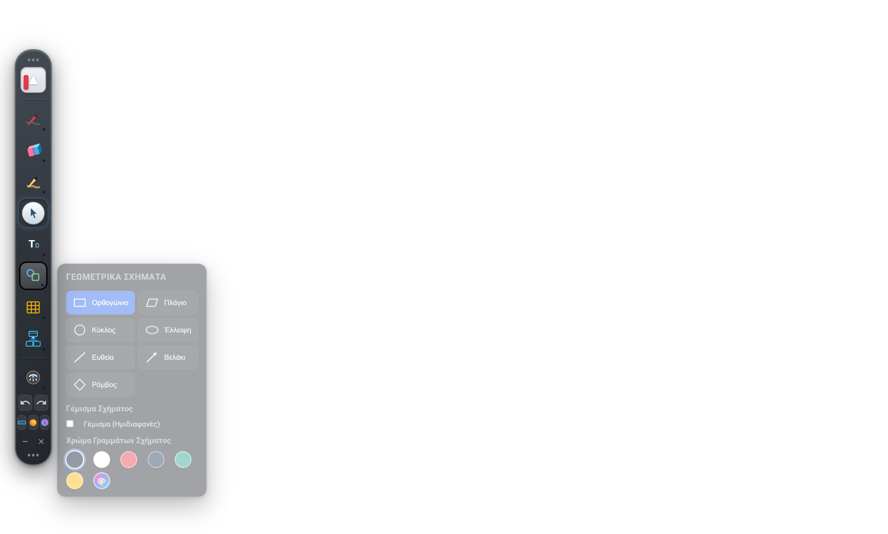
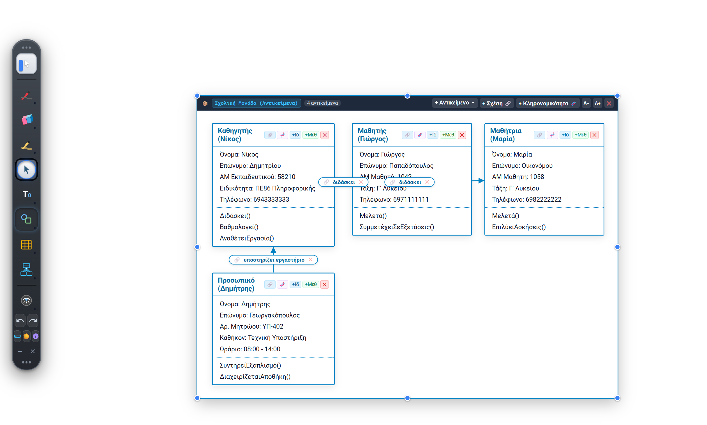
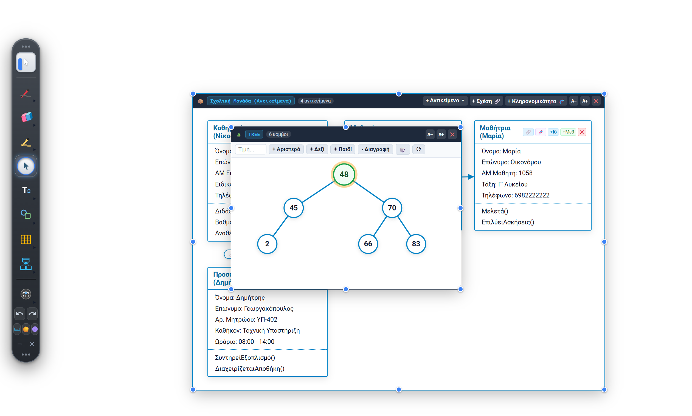

# myWhiteboard — Επίσημες Εκδόσεις & Τεκμηρίωση 🖊️📐

Το **myWhiteboard** είναι μια σύγχρονη, ταχύτατη και αυτόνομη εφαρμογή **Ψηφιακού Πίνακα (Whiteboard)** και **Σχολιασμού Επιφάνειας Εργασίας (Desktop Annotation)**, εμπνευσμένη από τα εργαλεία του OpenBoard. Είναι ειδικά σχεδιασμένη για εκπαιδευτικούς, μαθητές και επαγγελματίες, με πλήρη υποστήριξη μαθημάτων **Πληροφορικής (ΑΕΠΠ, ΓΛΩΣΣΑ, Python, Αντικειμενοστραφής Προγραμματισμός)** και Θετικών Επιστημών.

---

## 🚀 Άμεση Λήψη (Downloads - Έκδοση 1.1.2)

Μπορείτε να κατεβάσετε άμεσα την εφαρμογή και το επίσημο εγχειρίδιο χρήστη:

| Πακέτο | Τύπος | Περιγραφή | Σύνδεσμος Λήψης |
| :--- | :--- | :--- | :--- |
| 🚀 **myWhiteboard Portable** | `.exe` (~98 MB) | **Φορητή έκδοση χωρίς εγκατάσταση.** Τρέχει άμεσα από οποιονδήποτε φάκελο ή USB stick χωρίς δικαιώματα διαχειριστή. | [**Λήψη Portable (v1.1.2)**](https://github.com/pliroforikos/myWhiteboard-releases/releases/download/v1.1.2/myWhiteboard-Portable-1.1.2.exe) |
| 📦 **myWhiteboard Setup** | `.exe` (~99 MB) | **Πρόγραμμα εγκατάστασης Windows NSIS.** Δημιουργεί συντομεύσεις στην Επιφάνεια Εργασίας και στο μενού Έναρξη και διαθέτει uninstaller. | [**Λήψη Setup Installer (v1.1.2)**](https://github.com/pliroforikos/myWhiteboard-releases/releases/download/v1.1.2/myWhiteboard-Setup-1.1.2.exe) |
| 📕 **Εγχειρίδιο Χρήστη PDF** | `.pdf` (~1.9 MB) | **Πλήρες αναλυτικό εγχειρίδιο χρήστη 11 ενοτήτων σε μορφή A4**, έτοιμο για ανάγνωση και εκτύπωση. | [**Προβολή / Λήψη MANUAL.pdf**](./docs/MANUAL.pdf) |

> [!TIP]
> Όλες οι προηγούμενες και νεότερες εκδόσεις βρίσκονται συγκεντρωμένες στη σελίδα **[GitHub Releases](https://github.com/pliroforikos/myWhiteboard-releases/releases)**.

---

## 📸 Στιγμιότυπα Εφαρμογής (Screenshots)

### 1. Περιβάλλον Εργασίας & Παλέτα Εργαλείων (Whiteboard Dock)

*Κλασικός λευκός πίνακας με την κομψή, πλήρως μετακινούμενη εργαλειοθήκη και ένδειξη τρέχοντος εργαλείου.*

### 2. Φωτεινό Θέμα (Light Mode) & Γεωμετρικά Σχήματα

*Εξαιρετική αντίθεση και ευκρίνεια σε Light Mode, με δυναμικό auto-fit κειμένου μέσα σε ορθογώνια, κύκλους, παραλληλόγραμμα και ρόμβους.*

### 3. Διαγράμματα Αντικειμενοστραφούς Προγραμματισμού (OOP)

*Πλήρης σουίτα διαγραμμάτων αντικειμένων, κλάσεων και ιεραρχίας κληρονομικότητας με το επίσημο σύμβολο γενίκευσης UML (λευκό τρίγωνο ⮉).*

### 4. Διαδραστικές Δομές Δεδομένων (Δένδρα & Πίνακες)

*Δυαδικά δένδρα αναζήτησης (BST), πίνακες 1D/2D με επισήμανση διαγωνίων, στοίβες LIFO, ουρές FIFO και συνδεδεμένες λίστες.*

---

## 🌟 Κύρια Χαρακτηριστικά

- **🖱️ Click-Through Desktop Mode:** Στην εκκίνηση, το ποντίκι είναι διαπερατό, επιτρέποντάς σας να εργάζεστε κανονικά στο browser, σε PDF ή διαφάνειες PowerPoint, σχεδιάζοντας απευθείας πάνω στην οθόνη.
- **🌓 Dark Mode & Light Mode:** Δύο πλήρη θέματα εμφάνισης με αυστηρή τήρηση του προτύπου προσβασιμότητας WCAG AAA για κορυφαία ευκρίνεια σε οθόνες και προβολείς.
- **📐 7 Επιφάνειες Φόντου:** Επιφάνεια Εργασίας (Desktop Overlay), Λευκός Πίνακας, Καντριγιέ (Τετράδιο), Ριγέ, καθώς και σκούροι Μαυροπίνακες κιμωλίας με αυτόματη αντιστροφή χρώματος μολυβιού.
- **🏛️ Εκπαιδευτικό OOP Σχολικού Βιβλίου:** Διαγράμματα αντικειμένων (ιδιότητες, στικτή γραμμή, μέθοδοι), κλάσεις και ιεραρχίες κληρονομικότητας με έτοιμα πρότυπα (Σχολική Μονάδα, Οχήματα, e-Pizza, Αεροπορική Εταιρεία, Αγροτική Παραγωγή, Ψηφιακό Περιεχόμενο, Ανθοπωλείο).
- **▦ Δομές Δεδομένων & Αλγόριθμοι:**
  - **Πίνακες (1D/2D):** Επιλογή 0-based ή 1-based, τυχαίο γέμισμα, επισήμανση κύριας και δευτερεύουσας διαγωνίου.
  - **Στοίβες (LIFO):** Ώθηση/Απώθηση με δυναμικό δείκτη `top` και έλεγχο υπερχείλισης/υποχείλισης.
  - **Ουρές (FIFO):** Γραμμική ουρά (σχολικού βιβλίου με μηδενισμό δεικτών) και κυκλική ουρά.
  - **Συνδεδεμένες Λίστες:** Κόμβοι δεδομένων/δεικτών, κεφαλή `HEAD` και διαγραφή μεμονωμένων κόμβων.
  - **Δένδρα & Γράφοι:** Δυαδικά δένδρα, αριθμητικές εκφράσεις, δένδρα αποφάσεων και κατευθυνόμενοι γράφοι.
- **🔤 Ελεύθερη Σχεδίαση & Γραφή:**
  - Μολύβι με εξομάλυνση Bezier για φυσική γραφή.
  - Μαρκαδόρος υπογράμμισης (Highlighter) με διαφάνεια.
  - Σχήματα με **Dynamic Auto-Fit**: Τα γράμματα προσαρμόζονται αυτόματα στο μέγεθος του σχήματος!
  - Εργαλείο κειμένου & σημειώσεις Sticky Notes.
  - 100% Offline λειτουργία με ενσωματωμένη τη γραμματοσειρά Google Roboto (πλήρης υποστήριξη Ελληνικών).

---

## 📚 Αναλυτική Τεκμηρίωση (Docs)

Όλοι οι οδηγοί διατίθενται στον φάκελο [`docs/`](./docs/):

- 📕 [**Αναλυτικό Εγχειρίδιο Χρήστη σε PDF (MANUAL.pdf)**](./docs/MANUAL.pdf): Πλήρες επίσημο εγχειρίδιο χρήσης έτοιμο για εκτύπωση A4.
- 📘 [**Αναλυτικό Εγχειρίδιο Χρήστη σε Markdown (MANUAL.md)**](./docs/MANUAL.md): Πλήρης τεκμηρίωση 11 ενοτήτων με συντομεύσεις, συμβουλές και FAQ.
- 📖 [**Συνοπτικός Οδηγός Χρήσης (USER_GUIDE.md)**](./docs/USER_GUIDE.md): Γρήγορος οδηγός λειτουργιών και εργαλείων.
- 🏛️ [**Οδηγός Αντικειμενοστραφούς Προγραμματισμού (OOP_GUIDE.md)**](./docs/OOP_GUIDE.md): Ανάλυση αντικειμένων, κλάσεων και κληρονομικότητας.
- ▦ [**Οδηγός Δομών Δεδομένων (DATA_STRUCTURES_GUIDE.md)**](./docs/DATA_STRUCTURES_GUIDE.md): Πίνακες, στοίβες, ουρές, λίστες, δένδρα και γράφοι.
- ⚙️ [**Οδηγός Δημιουργίας Portable Έκδοσης (PORTABLE_BUILD.md)**](./docs/PORTABLE_BUILD.md): Οδηγίες εκτέλεσης και κατασκευής.

---

## ⌨️ Συντομεύσεις Πληκτρολογίου

| Συντόμευση | Εργαλείο / Ενέργεια |
| :--- | :--- |
| `M` | Ποντίκι (Mouse / Click-Through Mode) |
| `P` | Μολύβι (Pen) |
| `E` | Σβήστρα (Eraser) |
| `H` | Μαρκαδόρος Υπογράμμισης (Highlighter) |
| `S` | Γεωμετρικά Σχήματα (Shapes) |
| `T` | Εισαγωγή Κειμένου (Text) |
| `Shift + T` ή `F6` | **Εναλλαγή Θέματος: Σκοτεινό / Φωτεινό (Dark / Light Theme)** |
| `G` | Δομές Δεδομένων & Πίνακες (Grid / Data Structures) |
| `C` | Αντικειμενοστραφής Προγραμματισμός (OOP Suite) |
| `O` | Εναλλαγή Προσανατολισμού Παλέτας (Κάθετη ⇄ Οριζόντια) |
| `D` | Εναλλαγή Φόντου: Επιφάνεια Εργασίας ⇄ Λευκός Πίνακας |
| `I` | Παράθυρο Πληροφοριών & Στοιχείων Δημιουργού |
| `Ctrl + Z` / `Ctrl + Y` | Αναίρεση (Undo) / Επανάληψη (Redo) |
| `Esc` | Κλείσιμο ενεργών μενού και υποπαραθύρων |

---

## 👨‍🏫 Στοιχεία Δημιουργού

- **Δημιουργός:** **Λέων Προκόπης** &bull; *Καθηγητής Πληροφορικής*
- **Επίσημη Ιστοσελίδα:** [https://plarg.gr](https://plarg.gr)
- **Εκπαιδευτικό Υλικό:**
  - 📱 [Εφαρμογές Android στο Google Play](https://plarg.gr/android/)
  - 💻 [Εφαρμογές Windows για την Τάξη](https://plarg.gr/windows/)
  - 🛠️ [Διαδραστικά Online Εργαλεία](https://plarg.gr/tools/)
  - 📝 [Σημειώσεις & Εκπαιδευτικό Υλικό Πληροφορικής](https://plarg.gr/notes/)
- **Επικοινωνία:** `pliroforikos@gmail.com`
- **GitHub:** [@pliroforikos](https://github.com/pliroforikos)

---

## 📄 Άδεια Χρήσης

Το έργο διατίθεται υπό την άδεια ελεύθερου λογισμικού **MIT License**. Επιτρέπεται ελεύθερα η χρήση, μελέτη και αξιοποίηση για εκπαιδευτικούς και επαγγελματικούς σκοπούς.
